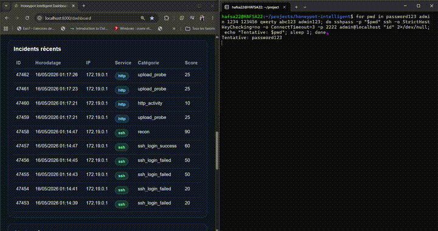

# Hafsa Daoudim · Developer Portfolio

> Full Stack Developer with a cybersecurity mindset. Former maths teacher, now building secure, intelligent applications.

**🌐 Live site:** [hafsa-daoudim.gitlab.io](https://hafsa-daoudim.gitlab.io/)

A single-page, cyberpunk-style portfolio with animations and an interactive assistant that answers questions about my skills and projects. It is plain HTML, CSS and JavaScript: no framework, no build step.

---

## 🎬 Honeypot demo



▶️ [Watch the full video](media/honeypot-demo.mp4)

---

## ✨ Features

- **Cyberpunk design** with neon accents, typing effect and scroll-reveal animations
- **Interactive assistant ("Haf")** that answers questions about my background, skills and projects, with optional voice input and spoken replies
- **Honeypot live-capture demo** embedded as a video
- **Project cards** with tech tags and links to the source code
- **Responsive layout** for desktop, tablet and mobile
- **Respects `prefers-reduced-motion`** for accessibility
- **Automatic deployment** to GitLab Pages through CI/CD

## 🧰 Tech stack

| Area | Tools |
|---|---|
| Front end | HTML5, CSS3 (Grid, custom properties, animations), vanilla JavaScript |
| Browser APIs | Web Speech API (recognition and synthesis), IntersectionObserver |
| Media | MP4 demo compressed with FFmpeg |
| Deployment | GitLab Pages, GitLab CI/CD |
| Tooling | VS Code, Git |

## 🗂️ Project structure

```
.
├── index.html              # The whole portfolio (markup, styles, scripts)
├── media/
│   ├── honeypot-demo.mp4   # Honeypot live-capture demo
│   └── honeypot-demo.gif   # Short preview used in this README
├── .gitlab-ci.yml          # Pages deployment pipeline
└── README.md
```

## 🚀 Run it locally

No installation is needed.

```bash
git clone https://github.com/Mamba1990/portfolio.git
cd portfolio
```

Then either open `index.html` in your browser, or serve it with the **Live Server** extension in VS Code, or:

```bash
python3 -m http.server 8000
# open http://localhost:8000
```

## 📦 Deployment

The site is deployed with **GitLab Pages**. Every push to the default branch triggers this pipeline (`.gitlab-ci.yml`):

```yaml
pages:
  stage: deploy
  script:
    - mkdir -p public
    - cp index.html public/
    - cp -r media public/
  artifacts:
    paths:
      - public
  rules:
    - if: $CI_COMMIT_BRANCH == $CI_DEFAULT_BRANCH
```

## 🔧 Customize it

- **Text and projects:** edit the corresponding sections in `index.html`.
- **Colours:** change the CSS variables at the top of the `<style>` block.
- **Assistant answers:** edit the assistant's knowledge in the `<script>` block.
- **Demo video:** replace `media/honeypot-demo.mp4`. To keep it light, compress it first:

  ```bash
  ffmpeg -i input.mp4 -vcodec libx264 -crf 28 -vf scale=1280:-2 -an media/honeypot-demo.mp4
  ```

## 🛡️ Featured projects

| Project | Stack | Source |
|---|---|---|
| HTTP & SSH Honeypot with anomaly detection | Python, Linux, Isolation Forest | [Code](https://github.com/Mamba1990/honeypot-intelligent) |
| Harmonia, music streaming platform | Node.js, React, MongoDB, JWT | _see portfolio_ |
| Airbnb Clone | Python, Flask, MySQL | _see portfolio_ |
| Simple Shell | C, Linux | _see portfolio_ |

## 📫 Contact

- 💼 LinkedIn: [linkedin.com/in/hafsadaoudim](https://www.linkedin.com/in/hafsadaoudim/)
- 💻 GitHub: [github.com/Mamba1990](https://github.com/Mamba1990)
- 🌐 Portfolio: [hafsa-daoudim.gitlab.io](https://hafsa-daoudim.gitlab.io/)
- 📍 Salé, Morocco

---

© Hafsa Daoudim. The code of this portfolio is free to read and learn from. Please don't copy the content or personal photo.
